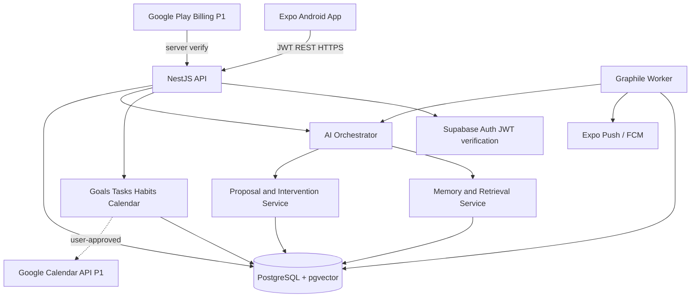

# Product Specification — Personal AI Life Companion

**Status:** Build-ready MVP specification (proposed, not implemented)  
**Updated:** 2026-11-06  
**Platform:** Android-first, cross-platform-capable  
**Audience:** Students and early-career professionals juggling goals, tasks, and personal growth  
**Working name:** Life Companion (replace once named)

## 0. Executive summary

Build an Android-first **personal AI life manager with a contextual companion**. It helps users organize tasks, goals, calendars, and habits; gives them room to reflect and discuss how they're doing; and improves its suggestions using a **user-controlled, provenance-aware knowledge graph** and a **feedback loop grounded in task outcomes**. The app is neither a therapist nor a productivity surveillance tool. The user remains the decision maker.

**Promise:** “Tell the app what matters to you. It helps you make progress each day, adapts when life gets in the way, and remembers only what you choose.”

**Core loop:** Capture → Understand → Plan → Start → Observe → Reflect → Adapt.

**North-star metric:** Weekly users who *voluntarily* complete at least one self-chosen goal-related action, with a positive self-reported usefulness score. Do not optimize screen time or compulsive engagement.

## 1. Product principles

1. **Action beats advice.** Every practical recommendation can become a concrete, editable action (except when the user only wants to reflect).
2. **Companionship without pressure.** Listen without reflexively turning emotions into tasks; ask before coaching or scheduling.
3. **Verified memory, not invented personality.** Facts are cited back to source interactions; interpretations are hypotheses requiring review. Memories can be corrected, forgotten, or disabled.
4. **Autonomy and dignity.** No guilt, shame, coercive push notifications, fabricated urgency, or dark patterns.
5. **Privacy as a feature.** Separate private conversation content from approved enduring memory; provide export and deletion.
6. **Reliable execution.** Scheduling, payments, authentication, and notifications are deterministic software, not free-form LLM output.
7. **Mobile first.** Fast quick capture, glanceable Today page, low-friction check-ins, robust notification behavior.
8. **Build measurable improvements.** Test usefulness and follow-through with user feedback; avoid making unsupported psychological inferences.

## 2. Goals and non-goals

### MVP goals (P0)
- Account creation, onboarding, settings, and privacy controls.
- Goals, projects, tasks, habits, and due dates; manual CRUD works independently of AI.
- Daily Today screen with plan review and progress.
- Conversational companion with opt-in memory capture and explicit review UI.
- Personal memory node/edge graph persisted in PostgreSQL; search and explain why memories were retrieved.
- AI-assisted goal decomposition and editable task-plan proposals.
- Focus Mode: start task, see next step, pause, complete or skip with reason.
- Evening check-in and lightweight adaptation based on observable outcomes.
- Local timezone-aware reminders and user-set quiet hours.
- Privacy controls: view, edit, delete, pause memory; delete/export account data.
- AI usage limits, spending budget, telemetry without sensitive transcript logging.

### P1 (after core beta)
- Google Calendar read-only availability sync and user-approved event creation.
- Weekly personal reports with source-backed observations and editable interpretations.
- Subscription management for Free and Plus.
- Offline task viewing/editing with sync and conflict handling.
- Improved graph explorer (read-only first, then user editing).

### P2 (later)
- More integrations, contextual bandit experimentation (with user consent), relationship management, voice, family/shared workspaces, sophisticated multi-hop graph analytics, autonomous but explicitly permissioned actions.

### Explicit non-goals for MVP
- No medical diagnosis, therapy, emotion-detection claims, or crisis intervention service.
- No scraping third-party private information or inferring sensitive user traits without permission.
- No unreviewed emailing, calendar edits, financial transactions, or contacting third parties.
- No ads targeting people based on intimate conversations. No selling personal memory.
- No full Neo4j deployment unless benchmarks establish a need.
- No social feed, gamified guilt/streak punishment, or generalized agent swarm.

## 3. Personas and jobs to be done

1. **Ambitious student:** Balances courses, applications, personal projects. “Help me decide what matters today and actually start.”
2. **Overcommitted early-career worker:** Deadlines, recurring habits, calendar conflicts. “Help me make realistic plans and recover from missed tasks.”
3. **Reflective planner:** Wants perspective without relentless efficiency pressure. “Let me talk things through and remember useful context if I choose.”

Primary initial segment: students and early-career professionals; do not generalize to all user categories before validation.

## 4. Core user journeys and acceptance criteria

### 4.1 Onboarding
1. Welcome and clear product explanation.
2. Register/login by email magic link or Google through Supabase Auth.
3. Set timezone (auto-detected then confirm), quiet hours, preferred communication approach: direct, supportive, exploratory, or mixed.
4. Optional three goals, recurring commitments, and desired daily check-in time.
5. Choose memory policy: **off by default for sensitive inferred information**. Explicitly present controls to enable user-confirmed persistent memories; conversational history retention and graph memory consent must be separate.
6. Show Today with one proposed next step (can be rejected).

**Accept:** A user can skip any goal or sensitive question, complete setup without calendar permissions, and change all settings later.

### 4.2 Today screen
- “Top priorities,” timeline, tasks due, habit check-ins, and AI briefing.
- Actions: add task, edit/reschedule, start focus, mark done, defer, ask companion.
- Proposed plans are always editable and accepted before becoming scheduled commitments.
- Display source of calendar events and last sync time.

**Accept:** Tasks can be created and completed without any AI call; changing a task updates UI optimistically with reliable rollback on error.

### 4.3 Companion chat
- Chats support productivity questions and open-ended reflection.
- The app offers “Just listen,” “Help me think,” and “Make a plan” response modes (user can change in conversation).
- A new persistent memory is a **suggestion**, not a hidden fact: user can approve or dismiss.
- Summaries should cite the relevant user utterance or task event; avoid fabricated familiarity.
- AI turns have visible loading/cancel/retry behavior and usage counters.

**Accept:** If memory is paused, conversation cannot write memory nodes or edges. Sensitive text never appears in analytics events or notification previews.

### 4.4 Goals, habits, and tasks
- Goal: title, why it matters, target timeframe, status, owner user, optional milestones.
- Project: linked goal, tasks, completion criteria.
- Task: title, notes, due_at, estimated_minutes, priority, status, linked goal, recurrence metadata.
- Habit: cadence, simple completion events, skip reason optional.
- AI may propose breakdowns; only explicit user approval persists changes.
- Dependencies between goals and tasks can be stored as graph edges, but transactional task state is canonical in task tables.

**Accept:** State changes are auditable and idempotent; deleting a goal doesn't silently delete user tasks without confirmation.

### 4.5 Focus / execution mode
- Start a task and show one next action, optional timer, steps, and progress.
- “I'm stuck” asks for obstacle: forgot, time, overwhelmed, uncertainty, low motivation, exhaustion, other/skip.
- Intervention picker: smaller first step, example, re-estimate time, defer, ask for help, rest.
- End session: completed/partial/skipped; user-confirmed outcome; optional subjective helpfulness rating.
- Record outcome and strategy attempted so future planning can adapt.

**Accept:** No automatic claim of completion based solely on opening or elapsed timer.

### 4.6 Daily check-in
- Morning: propose 1–3 realistic priorities based on available time, due dates, and user intent.
- Evening: concise recap, optional obstacle prompt, one adjustment for tomorrow.
- Server handles scheduled jobs, retries, idempotency; notifications respect quiet hours and timezone/DST.
- Users can turn off morning/evening check-ins separately.

**Accept:** No duplicate daily notification for same user, kind, and local date; no notifications when disabled.

### 4.7 Memory review and graph explorer
- “My World” contains approved facts, goals, experiences, projects, preferences, and relationships.
- Show an evidence link and date for each node/edge, with confirmed vs hypothesis indicators.
- Controls: confirm, edit, pin, delete, expire, pause collection, export.
- Personal graph edges may connect user nodes, not cross-user data.
- Do not surface sensitive inferred traits as definitive.

**Accept:** A user can delete a memory and stop it from appearing in retrieval or summaries immediately; permanent backend purging follows documented retention windows.

### 4.8 Billing (P1, designed in MVP)
- Free: manual productivity tools, **3 AI turns/day**, basic user-approved memory, limited AI planning.
- Plus: **$7.99/month proposed**; **600 AI turns per billing month**, daily adaptive planning, weekly insights, advanced integrations when shipped. Limits and included features must be shown clearly before purchase; revise after usage data.
- Never paywall account deletion, data export, privacy settings, or access to previously-created data.
- Verify Google Play subscription entitlement server-side, synchronize renewals/cancellations/refunds, and apply quotas on the server.
- Avoid implying unlimited access.

**Accept:** Free users always retain basic task CRUD; purchase success must not be trusted solely from a client callback; grace periods and subscription changes do not corrupt data.

## 5. Screen map

**Primary tabs:** `Today` | `Companion` | `My World`. Floating quick-add from Today; Goals/Projects accessible from Today.

- Auth: Welcome, Sign in, Account recovery.
- Onboarding: Goals, preferences, memory controls, notification permissions (asked in context), optional calendar.
- Today: daily plan, timeline, pending suggestions, next step.
- Task detail: edit, linked goal, steps, focus session history.
- Goals: list, goal detail, milestones, associated tasks.
- Companion: chat threads, mode picker, memory approval affordances.
- Focus: task step, timer, obstacle selection, summary.
- My World: memory list/search, provenance, graph visualization (P1), edit/delete.
- Reports: weekly review (P1).
- Settings: profile, timezone, quiet hours, notifications, memory and deletion/export, usage, subscription, integrations.

**UX guidelines:** Accessible text scaling, large touch targets, screen-reader labels, loading/error/empty/offline states, concise copy, light/dark themes, gentle notification behavior.

## 6. Technology decisions

| Component | Recommendation | Rationale |
| --- | --- | --- |
| Android app | React Native + Expo + TypeScript | Fast Android delivery with iOS reuse |
| App routing | Expo Router | Native-like route tree and deep links |
| UI | NativeWind + Reanimated | Maintainable styling and polish |
| Data client | TanStack Query | Cache, stale handling, invalidation |
| Transient state | Zustand | Limited client-only UI state |
| Backend | NestJS + TypeScript, REST + OpenAPI | Modular APIs and strong typing |
| Validation/contracts | Zod shared schemas | Versioned boundary validation |
| DB | Supabase PostgreSQL | Auth adjacency, transactions, managed backups |
| ORM / migrations | Prisma ORM + checked-in SQL migrations | User-directed choice; see ADR 0001 for database-specific SQL |
| Search | PostgreSQL full-text + pgvector | Keyword and semantic retrieval |
| Graph | `memory_nodes` + `memory_edges` in PostgreSQL | No second DB initially |
| Jobs | Graphile Worker with proper PostgreSQL connection | Durable scheduled/background tasks |
| Auth | Supabase Auth, JWT verified server-side | Standard OAuth/email sign-in |
| AI | OpenAI Responses API behind `LLMProvider` interface | Model routing and cost control |
| Notifications | Expo Notifications + Android FCM | Mobile push UX |
| Calendar (P1) | Google Calendar API | Explicit read/write scopes |
| Billing (P1) | Google Play Billing + server-side Play Developer API verification | Native subscriptions and enforceable entitlement |
| Errors | Sentry; redacted structured logs | Ops and crash detection |
| CI | GitHub Actions | Tests, lint, type checks, release gating |
| Delivery | EAS Android builds, NestJS on Linux VPS, Supabase cloud | Simple launch architecture |

Pin exact package/SDK versions at implementation time after checking current vendor compatibility. Expo Go is not the production test environment for all push/billing flows; use Android development/release builds.

### Architecture



**Data integrity rule:** PostgreSQL is the source of truth for transactional state. The graph stores the relationships and context, not duplicate authoritative task statuses.

## 7. Proposed repository structure

```text
/
  AGENTS.md                   # agent playbook and Codex instructions
  agents.md                   # original copy of agent playbook
  SPEC.md                     # this specification
  package.json               # pnpm workspaces + scripts
  pnpm-workspace.yaml
  apps/
    mobile/                   # Expo React Native
    api/                      # NestJS API
    worker/                   # background job runner
  packages/
    contracts/                # shared Zod schemas, typed DTOs
    db/                       # Drizzle schema, migrations, SQL
    domain/                   # pure business rules
    ai/                       # provider adapters, prompts, evaluators
    config/                   # shared lint/TS configuration
  docs/
    adr/                      # architecture decisions
    api/                      # OpenAPI output, examples
    runbooks/                 # backup, incident response, deletion
  tests/
    e2e/                      # mobile Maestro scripts
    fixtures/
```

## 8. Data model and invariants

Core tables (minimum recommended):

- `users_profile(id, timezone, locale, communication_style, quiet_hours_start, quiet_hours_end, created_at)` keyed to auth identity.
- `privacy_settings(user_id, save_chat_history, persistent_memory_enabled, sensitive_memory_requires_confirmation, analytics_opt_in, updated_at)`.
- `goals(id, user_id, title, motivation, status, target_at, created_at, updated_at)`.
- `projects(id, user_id, goal_id, title, status, created_at, updated_at)`.
- `tasks(id, user_id, project_id, goal_id, title, description, due_at, estimate_minutes, priority, status, recurrence_rule, created_at, updated_at)`.
- `habits(id, user_id, title, recurrence_rule, status)` and `habit_events(id, habit_id, user_id, day_local, result)`.
- `chat_threads(id, user_id, title, created_at)`; `chat_messages(id, thread_id, user_id, role, content_encrypted_or_protected, created_at, retention_until)`.
- `memory_nodes(id, user_id, type, label, canonical_json, confidence, confirmed, sensitivity, source_ref, observed_at, valid_from, valid_until, deleted_at)`.
- `memory_edges(id, user_id, source_node_id, target_node_id, relation_type, confidence, confirmed, source_ref, valid_from, valid_until, deleted_at)`.
- `memory_suggestions(id, user_id, source_message_id, proposal_json, status, created_at)` for pending approval.
- `memory_embeddings(node_id, user_id, model_id, vector, updated_at)` with dimension chosen for a specific embedding model.
- `focus_sessions(id, user_id, task_id, started_at, ended_at, outcome, obstacle, support_strategy, helpfulness)`.
- `plan_proposals(id, user_id, proposal_json, status, created_at, accepted_at)`.
- `notification_preferences(user_id, morning_enabled, evening_enabled, quiet_hours, local_times)` and `notification_deliveries(idempotency_key, user_id, kind, sent_at, outcome)`.
- `calendar_connections(user_id, provider, encrypted_refresh_token_ref, scopes, last_sync_at)` (P1).
- `subscriptions(user_id, provider, product_id, status, entitlement_until, verified_at)`; `usage_ledger(user_id, period_key, operation, tokens_in, tokens_out, estimated_usd, request_id)`.
- `audit_events(id, user_id, action, entity, entity_id, created_at, sanitized_metadata)`.

**Invariants:**
- Every user-owned row has `user_id`; ensure row-level security for client-accessible tables and backend authorization in every service.
- Memory edge endpoints must belong to the same user (enforce with composite keys, constraints, triggers, or service validation plus DB checks).
- Every extracted memory preserves source/provenance. Hypotheses are not promoted to fact without confirmation.
- Soft deletion affects retrieval immediately; purge/export workflows are documented and tested.
- Replays, notification jobs, billing webhooks, and approved external actions are idempotent.
- All dates stored UTC with named IANA timezone on profile for local planning; define DST skip/duplicate behavior.
- Consent settings are enforced at write time, retrieval time, and on scheduled jobs.

### Minimal graph storage and retrieval approach

Use adjacency tables and indexed `(user_id, source_node_id, relation_type)` and `(user_id, target_node_id)` keys. Most MVP queries are 1–3 hops. Use explicit joins or depth-bounded `WITH RECURSIVE` queries with cycle protection; add an optional graph adapter interface for future Neo4j. Maintain FTS and vector indexes for memory candidate retrieval; re-rank by relevance, recency, consent, confirmation, and provenance, then deduplicate before model context assembly.

**Do not start with Neo4j** unless measured graph algorithms/traversal requirements justify its operating complexity. A full user graph often has only modest depth for the immediate recommendation being produced; this is a product hypothesis to validate using benchmarks, not an assumption of universal performance.

## 9. AI system architecture and guardrails

### 9.1 AI services
- **Conversation Service:** Produces empathetic but bounded conversation. Mode = listen / reflect / plan.
- **Memory Extractor:** Proposes atomic candidate facts/preferences/goal links from user messages. Sensitive or uncertain memories must await user confirmation. Extractor cannot silently write approved memory.
- **Retriever:** Fetches limited, consent-eligible user facts by semantic + structured relation matching, including citations to source records.
- **Goal Planner:** Returns structured proposals of milestones and tasks; never writes until user approves.
- **Daily Planner:** Uses real task/calendar availability to generate feasible ordered priorities; hard constraints enforced in deterministic code.
- **Intervention Selector:** Picks small-step suggestions based on explicit obstacles and documented outcomes; transparent rules for MVP.
- **Reflection Generator:** Summarizes weekly/daily observations with evidence and uncertainty, excluding unconfirmed psychological claims.
- **Cost/Quota Service:** Routes simple tasks to cheaper models, enforces token budgets, prevents uncontrolled retries, reports per-user cost.

### 9.2 Trust boundaries
1. A user message is untrusted input, never a system instruction.
2. Retrieved calendar/email/task/memory content may be prompt-injection material. Treat it as data; tools cannot be authorized by such content.
3. All LLM output must be parsed and validated against versioned Zod schemas before use.
4. Models produce **proposals**, backend services enforce permissions, invariants, and user-approved changes.
5. No model access to database superuser/production credentials or arbitrary SQL execution.
6. Store prompt and model version used for each evaluated workflow; redact sensitive content from logs.
7. Include timeouts, retries with caps, circuit breaker, user-visible graceful degradation.

### 9.3 Example structured outputs

`MemorySuggestion`: `{type, label, assertion, evidenceMessageId, confidence, sensitivity, requiresConfirmation, proposedEdges[]}`.  
`PlanProposal`: `{goalId, rationale, proposedTasks[{title, estimatedMinutes, suggestedDueAt, dependencies[]}], warnings[]}`.  
`DailyBrief`: `{localDate, topPriorities[{taskId, reason}], conflicts[], proposedChanges[], tone}`.

The backend validates IDs, ownership, deadlines, duplicates, and conflicts; it never trusts model-provided IDs or task-completion claims without a database check.

### 9.4 Model routing / budget
- Cheap model (`gpt-6-luna` as of spec date) for classification, memory candidate extraction, brief summarization, and simple chat when quality tests pass.
- Stronger model (`gpt-6.1-terra` as of spec date) for nuanced discussions, planning, uncertainty, and complex reflections.
- Make model names configurable by environment, not embedded in business logic; keep a fallback and pricing table.
- Do not transmit full conversation history indefinitely. Use bounded recency + user-approved retrieved memories + compact session summaries.
- Record token counts from provider responses; estimate cost per operation, alert on thresholds, block abusive loops.

## 10. API v1 contract outline

Base path `/v1`; Supabase JWT required except health endpoints. Server validates `user_id` from JWT, not client body.

| Method | Endpoint | Behavior |
| --- | --- | --- |
| GET/PATCH | `/me` | Profile and preferences |
| GET/POST/PATCH/DELETE | `/goals` and `/goals/:id` | Goal CRUD |
| GET/POST/PATCH/DELETE | `/projects` and `/projects/:id` | Project CRUD |
| GET/POST/PATCH/DELETE | `/tasks` and `/tasks/:id` | Task CRUD |
| GET/POST | `/habits` and `/habits/:id/checkins` | Habit tracking |
| GET | `/today?localDate=YYYY-MM-DD` | Daily state and suggestions |
| POST | `/plans/propose` | Structured proposal; no mutation |
| POST | `/plans/:id/accept` | Explicit approved transaction |
| POST | `/chat/threads` | New thread |
| GET/POST | `/chat/threads/:id/messages` | Chat history and AI interaction |
| GET | `/memory/nodes` | Approved memory list |
| GET | `/memory/graph` | Paginated nodes/edges and provenance |
| GET/POST | `/memory/suggestions` and `/:id/decision` | Approval/deny |
| PATCH/DELETE | `/memory/nodes/:id` | Edit/forget |
| POST | `/focus/start` | New focus session |
| POST | `/focus/:id/finish` | Finish with outcome |
| GET/PATCH | `/settings/privacy` | Memory/history settings |
| GET/PATCH | `/settings/notifications` | Quiet hours/check-ins |
| GET | `/usage` | AI quota and tracked consumption |
| POST | `/data/export` | Async export, user-authenticated |
| DELETE | `/me` | Account deletion workflow |
| GET/POST | `/integrations/calendar` | Calendar status/consent (P1) |
| POST | `/billing/verify` | Purchase token verification (P1) |
| POST | `/webhooks/google-play` | Authenticated subscription events (P1) |

**Response conventions:** JSON; stable codes (`AUTH_REQUIRED`, `FORBIDDEN`, `VALIDATION_ERROR`, `RATE_LIMITED`, `QUOTA_EXCEEDED`, `UPSTREAM_UNAVAILABLE`, `CONFLICT`), request IDs, pagination cursors, idempotency keys for effectful operations. Publish OpenAPI and generate typed client hooks.

## 11. Calendar, reminders, and scheduling details

- P0 plans rely on in-app tasks and user-provided commitments.
- P1: Google Calendar OAuth with least-privilege scopes, separate read and write consent, encrypted refresh tokens; read availability through provider API, propose events, write only after user approval.
- Deduplicate imported events by provider + external ID, honor edits, record last sync time and connection failures.
- Device only handles user experience and push token registration; server worker calculates scheduling windows. Do not rely on guaranteed exact Android background execution.
- Reminder push payloads use generic wording (“You have a check-in ready”) to avoid exposing sensitive personal details on lock screens.
- Quiet-hour checks must happen at send time and use user's IANA timezone; handle timezone changes and daylight saving transitions.

## 12. Privacy, safety, and compliance requirements

- Encryption in transit (TLS), encryption at rest from managed services, secrets stored server-side.
- Restrict service role database access; never include API secrets, service keys, or OAuth refresh tokens in mobile builds.
- Server authorization + RLS defense in depth; rate limiting and abuse controls.
- Review logging to ensure secrets, private conversations, emotional journal entries, and embeddings are not sent to third-party analytics by default.
- Separate chat-history storage permission, graph-memory permission, and notification permission.
- Provide deletion, export, retention settings; document what third-party processors receive.
- Avoid claiming medical/mental-health effectiveness. The assistant is not a therapist; for acute safety situations respond supportively, encourage appropriate local/emergency support, and do not proceed with manipulative coaching.
- Never auto-infer or display definitive diagnoses, sexual/religious/political identities, or personal secrets from conversation context; sensitive candidates require explicit opt-in, and some should not be stored at all.
- Ensure privacy policy, store disclosures, and user rights flow are in place before public release; legal requirements vary by jurisdiction.

## 13. Monetization and unit economics

**Hypothesis to test:** Freemium (basic daily management) + Plus at $7.99/month. Free allowance 3 AI turns/day; Plus allowance 600 AI turns/billing month, separate fair-use caps on unusually large requests. A turn means one user AI request with its associated assistant response, not internal memory-processing calls. Quotas are enforced on the backend.

**Pricing anchors as of Nov 6, 2026 (verify before implementation):** Supabase Pro from $25/month; Neo4j Aura Professional from $0.09/GB-hour; OpenAI standard short-context tokens approximately GPT-6 Luna $0.10/$0.50 per 1M input/output, GPT-6.1 Terra $1/$5 per 1M input/output. For US Play Billing subscriptions, current fee schedule references 10% service + 5% billing fee for qualifying purchases. Pricing may change.

**Illustrative cost scenario:** 600 user turns/month × (3,000 input + 600 output tokens) per turn, 75% Luna / 25% Terra = ~**$1.17** core generation tokens per user-month, *excluding* memory extraction, embeddings, retries, premium tools, overhead, and taxes. Assume $0.83 additional variable cost per user for planning only (not measured). $7.99 × 0.85 − $2.00 ≈ **$4.79 contribution** per paid subscriber before fixed costs. A hypothetical $50/month fixed bill would need approximately **11** such paid subscribers to cover it. These figures are not profit forecasts or measured usage.

**Cost controls:** Per-user and systemwide token budgets; bounded prompts; async batching where appropriate; cheap-model routing; monthly and daily spend alerts; request idempotency; plan-tier usage counters; abuse protection; no unlimited high-cost tool use. Evaluate costs on p50/p95/p99 user usage and heavy-user scenarios, not just averages.

**Monetization guardrails:** Avoid targeted ads based on journals/mood; show quotas transparently; do not make deletion/export dependent on a subscription; validate store billing rules for each supported region.

## 14. Analytics and experiments

Events allowed: onboarding_completed, goal_created, plan_proposed, plan_accepted, focus_started, focus_finished, task_completed, task_deferred, reminder_delivered, reminder_opened, memory_suggestion_approved/rejected, ai_turn_completed, ai_turn_failed, subscription_started/cancelled. Event payloads must not contain raw personal content.

Primary weekly metrics:
- Active users who complete >=1 self-chosen action / weekly active users.
- Advice-to-action funnel: proposed → accepted → started → user-confirmed completed.
- Retention weeks 1, 4, 8; user-reported helpfulness / autonomy / notification annoyance.
- Memory suggestion acceptance/correction/deletion; retrieval precision measured by human-reviewed privacy-safe test fixtures.
- Latency p50/p95, job delivery, failure rates, model and infrastructure cost per active user.

**Experiment design:** A/B test plain reminders versus adaptive obstacle-specific suggestions after collecting consent and ensuring safe UX. Keep randomized cohorts, define primary outcome beforehand, measure completion and annoyance, and do not claim causality from observational correlations alone.

## 15. Release plan and definition of done

### Milestone M0 — foundations
- Monorepo, lint/typecheck/test CI, environment templates, auth, DB migrations, health probes, basic observability.
- Exit: fresh developer can run mobile/API/worker locally with documented setup; no secret committed.

### Milestone M1 — useful without AI
- Goals/tasks/habits CRUD, Today page, timezone, reminders, simple Focus Mode.
- Exit: a tester can plan and complete a full day without any AI provider configured.

### Milestone M2 — companion and memory
- Chat, bounded context, memory suggestion review, provenance, forget/pause, graph retrieval, cost quotas.
- Exit: tests prove denied memories never enter retrieval; chat still works if memory is disabled.

### Milestone M3 — execution feedback
- Goal plans, task proposals/approval, check-ins, focus obstacle support, outcome records, weekly QA scenarios.
- Exit: plans never silently modify user data; feedback affects only transparent, user-acceptable suggestions.

### Milestone M4 — beta hardening
- Notifications, error/offline handling, Play internal testing, account deletion/export, performance and security checks, costs dashboard.
- Exit: no open P0/P1 privacy/security bugs, repeatable release process, tested Android install.

### Milestone M5 — paid + calendar (P1)
- Google Calendar scopes and consent, Play subscription verification, quota enforcement, weekly reports.
- Exit: billing works with renewals/refunds/cancellations and verified server entitlement.

## 16. Nonfunctional requirements / targets (engineering targets, not measured facts)

- 99% of non-AI API calls under 500ms p95 under nominal beta load; AI responses stream when feasible.
- No cross-user access even with guessed IDs (automated multi-tenant security tests).
- Re-entrant/idempotent daily and billing jobs; all scheduled triggers observable.
- Graceful app behavior if AI is unavailable; manual task functionality remains usable.
- Android app launch and quick-add are responsive on modest devices; tune after device profiling.
- Restore-tested backups, documented deletion and incident runbooks.
- Accessibility checks (screen reader, scaled fonts, contrast) for core flows.
- No production release without staging verification and manual user-flow QA.

## 17. Acceptance test examples (must automate where appropriate)

1. User A cannot query User B's goal/task/memory/graph via any endpoint, including multi-hop traversal.
2. Disabling persistent memory prevents all new graph writes; chat remains usable.
3. Memory proposal is rejected; it never appears in graph or AI retrieval.
4. User deletes memory; subsequent queries and daily reflections do not surface it.
5. AI plan proposal changes no tasks before acceptance.
6. Duplicate accept requests create at most one set of tasks.
7. Cancelled subscription downgrades quota at appropriate entitlement expiry without deleting user data.
8. A notification scheduled within quiet hours is delayed or suppressed according to settings.
9. LLM returns malformed JSON / unauthorized tool operation: backend rejects it and returns safe error.
10. User has no network: task UI shows cached state and does not falsely claim completion/sync.
11. User changes timezone across DST: daily check-ins run once at intended local time where valid.
12. Sensitive emotion disclosed in chat: assistant can respond supportively without turning it into an unapproved permanent memory.

## 18. Decisions and open questions

Locked for MVP: Android-first; Expo, TypeScript, NestJS, PostgreSQL, pgvector, explicit memory consent, backend worker, no silent action execution.  
Product questions for beta: Is the strongest trigger morning planning, task-start friction, or evening review? Do users choose chat vs Today? Which memory review frequency feels trustworthy? What limits keep the free plan useful without enabling abuse? Will people pay $7.99/month? Test rather than assume.

## 19. Reference documentation (verified 2026-11-06)

- Supabase pricing: https://supabase.com/pricing
- PostgreSQL recursive queries: https://www.postgresql.org/docs/current/queries-with.html
- Neo4j Aura pricing: https://neo4j.com/pricing/
- OpenAI pricing: https://developers.openai.com/api/docs/pricing
- Google Play service fees: https://support.google.com/googleplay/android-developer/answer/112622
- Google Play Billing: https://developer.android.com/google/play/billing

**Specification changes:** For any meaningful departure from these choices, write an ADR and update this file before implementing a divergent architecture.
