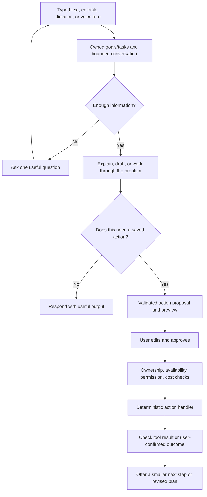

# Execution layer: from a conversation to useful action

Status: architecture for the next execution slice, with current capabilities distinguished below. This document does not claim an autonomous action runner, browser, email sender, external calendar integration, or focus worker has shipped.

The core loop is **understand → clarify → help → propose → approve → execute → verify → adapt**. The assistant should solve what it can in the conversation (explain a concept, work through an example, compare options, draft text) and turn requested commitments into a small, editable action.

## Interaction design

For “I keep avoiding exam revision,” ask what is blocking the next step rather than asserting a psychological cause. If the user does not understand a topic, ask for the question or source material and work through it. If the problem is available time, ask for the deadline and actual free slots. If it feels too large, suggest one small first step. Give one useful intervention, then ask whether it helped; do not generate an unbounded chain of advice or calls.

Modes are explicit: **Just listen** gives space and does not propose productivity work; **Help me think** clarifies the problem and explains options; **Make a plan** can suggest a goal-linked plan for review. The current goal/task status is evidence, not conversation claims about completion.

## Components to build next

1. **Intent and context assembly.** Read the authenticated user's relevant goal/task, recent turns, and only explicitly approved memories once memory retrieval exists. Label user claims, database observations, and uncertain hypotheses. Bound context, latency, tokens, and calls.
2. **Typed action registry.** Each supported action gets a Zod input/output contract, required permission, preview function, deterministic execute handler, and verification strategy. Begin with in-app task creation, task rescheduling, and focus support. Add external integrations only when their actual APIs and permissions exist. Model text never supplies arbitrary URLs, SQL, shell commands, credentials, or executable code.
3. **Proposal and authorization gate.** Display exact changes before writes: goal, task titles, time estimates, calendar slots, and any external recipient. Recheck ownership and conflicts at commit time. Material changes after approval need a fresh preview. The existing atomic plan-approval path is the first implementation of this gate.
4. **Durable runner.** Persist an execution record with request/idempotency ID and transitions: proposed → approved → running → succeeded / needs_input / failed / cancelled. Use the existing Graphile Worker choice for long/retryable work when it is implemented. Retry only deterministic transient failures with bounded attempts; reconcile uncertain external outcomes before retrying. Surface progress and cancellation honestly.
5. **Outcome verification and adaptation.** A successful task-creation API call means the task exists; it does not mean the user did the work. A personal task remains awaiting an explicit completion outcome. Missed/partial work can prompt a question or smaller revised plan, never an invented completion. New scheduling changes still require approval.

Acceptance for that next slice: duplicate approval creates one execution; another tenant's goal/task cannot be used; malicious context cannot add a tool; cancellation causes no later new action; stale availability is rejected; provider failure causes no partial writes; task completion requires explicit evidence; retries do not bypass cost limits.

## What is implemented now

- Goal/task-grounded Companion replies, bounded recent context, Listen/Think/Plan mode, and an optional validated affordance for an owned goal plan.
- Existing AI goal-plan proposals, editable schedule preview, deterministic capacity/conflict checks, explicit atomic/idempotent approval, Today/calendar task display, and user task completion/reopening.
- Editable speech-to-text drafts and turn-based voice chat. Device speech reads replies aloud; ending voice chat puts both sides in text chat. These share conversation policy rather than bypassing action approval.
- Separately opt-in encrypted chat history, no raw-audio persistence, no automatic graph memory, shared AI request quotas, cancellation guards, and tenant ownership checks.

## What is not implemented yet

The general action registry and durable execution records, focus coaching loop, automatic replanning, approved-memory retrieval, web research, document retrieval, external actions, and integration-backed outcome verification are future work. Current chat must explain those limits and cannot claim it has performed them.
